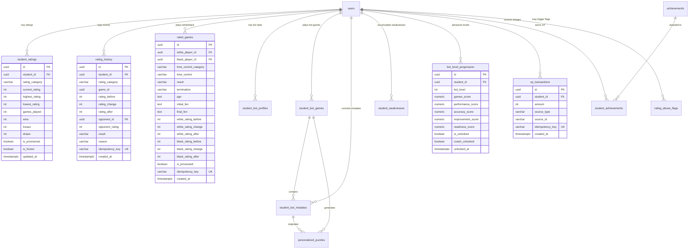

# ChessHub Academy: Rating & Bot Database Schema Blueprint
## Phase 2 Database Architecture & Data Migration Specification

**Document:** `docs/RATING_DATABASE_DESIGN.md`  
**Status:** ARCHITECTURE DESIGN ONLY — NOT EXECUTED  
**Date:** September 27, 2026  
**Target:** ChessHub Academy Production Database (PostgreSQL / Supabase)  

---

### 1. Entity Relationship Diagram (ERD)



---

### 2. Comprehensive Table Definitions

#### 2.1. `public.student_ratings` (New Canonical Rating Table)
Stores per-student, per-category rating state.

```sql
CREATE TABLE IF NOT EXISTS public.student_ratings (
  id               UUID PRIMARY KEY DEFAULT gen_random_uuid(),
  student_id       UUID NOT NULL REFERENCES public.users(id) ON DELETE CASCADE,
  rating_category  VARCHAR(20) NOT NULL CHECK (rating_category IN ('blitz', 'rapid', 'classical', 'bot', 'puzzle')),
  current_rating   INTEGER NOT NULL DEFAULT 400,
  highest_rating   INTEGER NOT NULL DEFAULT 400,
  lowest_rating    INTEGER NOT NULL DEFAULT 400,
  games_played     INTEGER NOT NULL DEFAULT 0,
  wins             INTEGER NOT NULL DEFAULT 0,
  losses           INTEGER NOT NULL DEFAULT 0,
  draws            INTEGER NOT NULL DEFAULT 0,
  is_provisional   BOOLEAN NOT NULL DEFAULT true,
  is_frozen        BOOLEAN NOT NULL DEFAULT false,
  created_at       TIMESTAMPTZ NOT NULL DEFAULT timezone('utc'::text, now()),
  updated_at       TIMESTAMPTZ NOT NULL DEFAULT timezone('utc'::text, now()),
  UNIQUE(student_id, rating_category)
);

CREATE INDEX IF NOT EXISTS idx_student_ratings_category_rating 
  ON public.student_ratings (rating_category, current_rating DESC);
CREATE INDEX IF NOT EXISTS idx_student_ratings_student 
  ON public.student_ratings (student_id);
```

#### 2.2. `public.rating_history` (New Immutable Audit Log)
Captures every rating change event across human, bot, and puzzle games.

```sql
CREATE TABLE IF NOT EXISTS public.rating_history (
  id               UUID PRIMARY KEY DEFAULT gen_random_uuid(),
  student_id       UUID NOT NULL REFERENCES public.users(id) ON DELETE CASCADE,
  rating_category  VARCHAR(20) NOT NULL CHECK (rating_category IN ('blitz', 'rapid', 'classical', 'bot', 'puzzle')),
  game_id          UUID,
  rating_before    INTEGER NOT NULL,
  rating_change    INTEGER NOT NULL,
  rating_after     INTEGER NOT NULL,
  opponent_id      UUID REFERENCES public.users(id) ON DELETE SET NULL,
  opponent_rating  INTEGER,
  result           VARCHAR(10) NOT NULL CHECK (result IN ('win', 'loss', 'draw')),
  reason           VARCHAR(50) DEFAULT 'game_complete',
  idempotency_key  VARCHAR(150) UNIQUE NOT NULL,
  created_at       TIMESTAMPTZ NOT NULL DEFAULT timezone('utc'::text, now())
);

CREATE INDEX IF NOT EXISTS idx_rating_history_student_cat_date 
  ON public.rating_history (student_id, rating_category, created_at DESC);
CREATE INDEX IF NOT EXISTS idx_rating_history_game 
  ON public.rating_history (game_id);
```

#### 2.3. `public.rated_games` (New Human-vs-Human Matches)
Tracks rated matches played between academy students.

```sql
CREATE TABLE IF NOT EXISTS public.rated_games (
  id                    UUID PRIMARY KEY DEFAULT gen_random_uuid(),
  white_player_id       UUID NOT NULL REFERENCES public.users(id) ON DELETE CASCADE,
  black_player_id       UUID NOT NULL REFERENCES public.users(id) ON DELETE CASCADE,
  time_control_category VARCHAR(20) NOT NULL CHECK (time_control_category IN ('blitz', 'rapid', 'classical')),
  time_control          VARCHAR(20) NOT NULL,
  status                VARCHAR(20) NOT NULL DEFAULT 'completed' CHECK (status IN ('in_progress', 'completed', 'abandoned')),
  result                VARCHAR(20) NOT NULL CHECK (result IN ('white_win', 'black_win', 'draw', 'in_progress')),
  termination           VARCHAR(30) NOT NULL DEFAULT 'checkmate',
  pgn                   TEXT,
  initial_fen           TEXT NOT NULL DEFAULT 'rnbqkbnr/pppppppp/8/8/8/8/PPPPPPPP/RNBQKBNR w KQkq - 0 1',
  final_fen             TEXT,
  move_count            INTEGER DEFAULT 0,
  white_rating_before   INTEGER NOT NULL,
  white_rating_change   INTEGER NOT NULL DEFAULT 0,
  white_rating_after    INTEGER NOT NULL,
  black_rating_before   INTEGER NOT NULL,
  black_rating_change   INTEGER NOT NULL DEFAULT 0,
  black_rating_after    INTEGER NOT NULL,
  is_processed          BOOLEAN NOT NULL DEFAULT true,
  idempotency_key       VARCHAR(150) UNIQUE NOT NULL,
  started_at            TIMESTAMPTZ NOT NULL DEFAULT timezone('utc'::text, now()),
  ended_at              TIMESTAMPTZ DEFAULT timezone('utc'::text, now()),
  created_at            TIMESTAMPTZ NOT NULL DEFAULT timezone('utc'::text, now())
);

CREATE INDEX IF NOT EXISTS idx_rated_games_white ON public.rated_games (white_player_id, created_at DESC);
CREATE INDEX IF NOT EXISTS idx_rated_games_black ON public.rated_games (black_player_id, created_at DESC);
CREATE INDEX IF NOT EXISTS idx_rated_games_category ON public.rated_games (time_control_category, created_at DESC);
```

#### 2.4. `public.bot_level_progression` (New Adaptive Unlock Tracker)
Stores readiness metrics preventing bot farming.

```sql
CREATE TABLE IF NOT EXISTS public.bot_level_progression (
  id                 UUID PRIMARY KEY DEFAULT gen_random_uuid(),
  student_id         UUID NOT NULL REFERENCES public.users(id) ON DELETE CASCADE,
  bot_level          INTEGER NOT NULL CHECK (bot_level BETWEEN 1 AND 10),
  games_score        NUMERIC(5,2) NOT NULL DEFAULT 0,
  performance_score  NUMERIC(5,2) NOT NULL DEFAULT 0,
  accuracy_score     NUMERIC(5,2) NOT NULL DEFAULT 0,
  improvement_score  NUMERIC(5,2) NOT NULL DEFAULT 0,
  readiness_score    NUMERIC(5,2) NOT NULL DEFAULT 0,
  is_unlocked        BOOLEAN NOT NULL DEFAULT false,
  coach_unlocked     BOOLEAN NOT NULL DEFAULT false,
  unlocked_at        TIMESTAMPTZ,
  updated_at         TIMESTAMPTZ NOT NULL DEFAULT timezone('utc'::text, now()),
  UNIQUE(student_id, bot_level)
);

CREATE INDEX IF NOT EXISTS idx_bot_progression_student ON public.bot_level_progression (student_id);
```

#### 2.5. `public.xp_transactions` (New Server-Validated XP Ledger)
Prevents duplicate XP farming.

```sql
CREATE TABLE IF NOT EXISTS public.xp_transactions (
  id               UUID PRIMARY KEY DEFAULT gen_random_uuid(),
  student_id       UUID NOT NULL REFERENCES public.users(id) ON DELETE CASCADE,
  amount           INTEGER NOT NULL CHECK (amount > 0),
  source_type      VARCHAR(50) NOT NULL CHECK (source_type IN ('bot_game', 'puzzle', 'homework', 'achievement', 'streak', 'tournament')),
  source_id        VARCHAR(100),
  idempotency_key  VARCHAR(150) UNIQUE NOT NULL,
  created_at       TIMESTAMPTZ NOT NULL DEFAULT timezone('utc'::text, now())
);

CREATE INDEX IF NOT EXISTS idx_xp_student_date ON public.xp_transactions (student_id, created_at DESC);
```

#### 2.6. `public.achievements` & `public.student_achievements`
```sql
CREATE TABLE IF NOT EXISTS public.achievements (
  id          UUID PRIMARY KEY DEFAULT gen_random_uuid(),
  code        VARCHAR(50) UNIQUE NOT NULL,
  title       TEXT NOT NULL,
  description TEXT NOT NULL,
  category    VARCHAR(30) NOT NULL DEFAULT 'GENERAL',
  badge_icon  TEXT NOT NULL,
  xp_reward   INTEGER NOT NULL DEFAULT 100,
  is_active   BOOLEAN NOT NULL DEFAULT true,
  created_at  TIMESTAMPTZ NOT NULL DEFAULT timezone('utc'::text, now())
);

CREATE TABLE IF NOT EXISTS public.student_achievements (
  id              UUID PRIMARY KEY DEFAULT gen_random_uuid(),
  student_id      UUID NOT NULL REFERENCES public.users(id) ON DELETE CASCADE,
  achievement_id  UUID NOT NULL REFERENCES public.achievements(id) ON DELETE CASCADE,
  unlocked_at     TIMESTAMPTZ NOT NULL DEFAULT timezone('utc'::text, now()),
  UNIQUE(student_id, achievement_id)
);

CREATE INDEX IF NOT EXISTS idx_student_achievements_student ON public.student_achievements (student_id);
```

#### 2.7. `public.rating_abuse_flags` (Anti-Abuse Repository)
```sql
CREATE TABLE IF NOT EXISTS public.rating_abuse_flags (
  id           UUID PRIMARY KEY DEFAULT gen_random_uuid(),
  student_id   UUID NOT NULL REFERENCES public.users(id) ON DELETE CASCADE,
  flag_reason  VARCHAR(100) NOT NULL,
  severity     VARCHAR(20) NOT NULL DEFAULT 'MEDIUM' CHECK (severity IN ('LOW', 'MEDIUM', 'HIGH', 'CRITICAL')),
  status       VARCHAR(20) NOT NULL DEFAULT 'PENDING' CHECK (status IN ('PENDING', 'REVIEWED', 'DISMISSED', 'PENALIZED')),
  reviewed_by  UUID REFERENCES public.users(id) ON DELETE SET NULL,
  reviewed_at  TIMESTAMPTZ,
  details      JSONB DEFAULT '{}'::jsonb,
  created_at   TIMESTAMPTZ NOT NULL DEFAULT timezone('utc'::text, now())
);

CREATE INDEX IF NOT EXISTS idx_rating_abuse_status ON public.rating_abuse_flags (status, created_at DESC);
```

---

### 3. Additive Modifications to Existing Tables

```sql
-- 1. Add normalized country to users
ALTER TABLE IF EXISTS public.users
  ADD COLUMN IF NOT EXISTS country VARCHAR(100);

CREATE INDEX IF NOT EXISTS idx_users_country_active ON public.users (country, is_active);

-- 2. Add starting position source & opening stats to student_bot_games
ALTER TABLE IF EXISTS public.student_bot_games
  ADD COLUMN IF NOT EXISTS starting_position_type VARCHAR(20) DEFAULT 'NORMAL' CHECK (starting_position_type IN ('NORMAL', 'OPENING', 'MISTAKE', 'WEAKNESS')),
  ADD COLUMN IF NOT EXISTS opening_name TEXT,
  ADD COLUMN IF NOT EXISTS eco VARCHAR(10),
  ADD COLUMN IF NOT EXISTS accuracy NUMERIC(5,2),
  ADD COLUMN IF NOT EXISTS blunders_count INTEGER DEFAULT 0,
  ADD COLUMN IF NOT EXISTS mistakes_count INTEGER DEFAULT 0;

-- 3. Add solve tracking to student_bot_mistakes
ALTER TABLE IF EXISTS public.student_bot_mistakes
  ADD COLUMN IF NOT EXISTS attempt_status VARCHAR(20) DEFAULT 'unattempted' CHECK (attempt_status IN ('unattempted', 'solved', 'failed')),
  ADD COLUMN IF NOT EXISTS attempts_count INTEGER DEFAULT 0,
  ADD COLUMN IF NOT EXISTS solve_time_seconds INTEGER,
  ADD COLUMN IF NOT EXISTS solved_at TIMESTAMPTZ,
  ADD COLUMN IF NOT EXISTS coach_assigned BOOLEAN DEFAULT false,
  ADD COLUMN IF NOT EXISTS coach_notes TEXT;

-- 4. Add trend and coach overrides to student_weaknesses
ALTER TABLE IF EXISTS public.student_weaknesses
  ADD COLUMN IF NOT EXISTS trend VARCHAR(20) DEFAULT 'STABLE' CHECK (trend IN ('IMPROVING', 'STABLE', 'WORSENING')),
  ADD COLUMN IF NOT EXISTS coach_approved BOOLEAN DEFAULT true,
  ADD COLUMN IF NOT EXISTS coach_override_severity VARCHAR(10),
  ADD COLUMN IF NOT EXISTS coach_notes TEXT,
  ADD COLUMN IF NOT EXISTS coach_override_by UUID REFERENCES public.users(id);
```

---

### 4. Row Level Security (RLS) Strategy & Policy Definitions

#### 4.1. Remediating Insecure Legacy Policies
The previous migration `20260825000001_bot_training_rls.sql` permitted authenticated students to directly `UPDATE` their `student_bot_profiles` and `INSERT` into `student_bot_rating_history`.

```sql
-- DROP INSECURE POLICIES:
DROP POLICY IF EXISTS "student_can_update_own_bot_profile" ON public.student_bot_profiles;
DROP POLICY IF EXISTS "student_can_insert_own_rating_history" ON public.student_bot_rating_history;
DROP POLICY IF EXISTS "student_can_upsert_own_weaknesses" ON public.student_weaknesses;
DROP POLICY IF EXISTS "student_can_update_own_weaknesses" ON public.student_weaknesses;
```

#### 4.2. New Secure RLS Model
All rating calculations and rating modifications are performed **server-side** with `service_role` (admin client) in Server Actions. Student direct modifications are blocked at the PostgreSQL level.

```sql
-- ENABLE RLS ON ALL TABLES:
ALTER TABLE public.student_ratings ENABLE ROW LEVEL SECURITY;
ALTER TABLE public.rating_history ENABLE ROW LEVEL SECURITY;
ALTER TABLE public.rated_games ENABLE ROW LEVEL SECURITY;
ALTER TABLE public.bot_level_progression ENABLE ROW LEVEL SECURITY;
ALTER TABLE public.xp_transactions ENABLE ROW LEVEL SECURITY;
ALTER TABLE public.achievements ENABLE ROW LEVEL SECURITY;
ALTER TABLE public.student_achievements ENABLE ROW LEVEL SECURITY;
ALTER TABLE public.rating_abuse_flags ENABLE ROW LEVEL SECURITY;

-- ── student_ratings ──────────────────────────────────────────
-- Students can read their own ratings
CREATE POLICY "student_read_own_ratings" ON public.student_ratings
  FOR SELECT TO authenticated
  USING (student_id = auth.uid());

-- Coaches can read assigned students' ratings
CREATE POLICY "coach_read_assigned_student_ratings" ON public.student_ratings
  FOR SELECT TO authenticated
  USING (
    EXISTS (
      SELECT 1 FROM public.coach_student_assignments csa
      JOIN public.student_profiles sp ON sp.id = csa.student_id
      WHERE sp.user_id = public.student_ratings.student_id
        AND csa.coach_id = auth.uid()
        AND csa.archived_at IS NULL
    )
    OR EXISTS (SELECT 1 FROM public.users WHERE id = auth.uid() AND role = 'ADMIN')
  );

-- No client insert/update/delete allowed (Service Role Only)

-- ── rating_history ───────────────────────────────────────────
CREATE POLICY "student_read_own_rating_history" ON public.rating_history
  FOR SELECT TO authenticated
  USING (student_id = auth.uid());

CREATE POLICY "coach_read_assigned_rating_history" ON public.rating_history
  FOR SELECT TO authenticated
  USING (
    EXISTS (
      SELECT 1 FROM public.coach_student_assignments csa
      JOIN public.student_profiles sp ON sp.id = csa.student_id
      WHERE sp.user_id = public.rating_history.student_id
        AND csa.coach_id = auth.uid()
        AND csa.archived_at IS NULL
    )
    OR EXISTS (SELECT 1 FROM public.users WHERE id = auth.uid() AND role = 'ADMIN')
  );

-- ── rated_games ──────────────────────────────────────────────
CREATE POLICY "players_read_own_rated_games" ON public.rated_games
  FOR SELECT TO authenticated
  USING (
    white_player_id = auth.uid() 
    OR black_player_id = auth.uid()
    OR EXISTS (SELECT 1 FROM public.users WHERE id = auth.uid() AND role IN ('COACH', 'ADMIN'))
  );

-- ── xp_transactions ──────────────────────────────────────────
CREATE POLICY "student_read_own_xp" ON public.xp_transactions
  FOR SELECT TO authenticated
  USING (student_id = auth.uid());

-- ── achievements ─────────────────────────────────────────────
CREATE POLICY "anyone_authenticated_read_achievements" ON public.achievements
  FOR SELECT TO authenticated USING (true);

CREATE POLICY "student_read_own_achievements" ON public.student_achievements
  FOR SELECT TO authenticated USING (student_id = auth.uid());

-- ── rating_abuse_flags ───────────────────────────────────────
CREATE POLICY "staff_manage_abuse_flags" ON public.rating_abuse_flags
  FOR ALL TO authenticated
  USING (EXISTS (SELECT 1 FROM public.users WHERE id = auth.uid() AND role IN ('COACH', 'ADMIN')));
```

---

### 5. Safe Data Migration Strategy: OLD SYSTEM $\to$ NEW SYSTEM

To guarantee **zero downtime and zero data loss**, the migration pipeline executes four distinct steps:

```
[OLD SYSTEM]
- student_profiles.notes: "=== CHESSHUB_STATS === {"tacticalRating": 1200, "xp": 450, ...}"
- student_bot_profiles.rating: (Bot Rating, e.g. 640)
- student_profiles.notes: "{"country": "India"}"

                      │
                      ▼
[MIGRATION STEP 1: SCHEMA INITIALIZATION]
- Create student_ratings, rating_history, rated_games, xp_transactions without constraints.
- Add country column to public.users.

                      │
                      ▼
[MIGRATION STEP 2: DATA BACKFILL & SEEDING]
1. Seed default 400 ratings for all existing users:
   - For every student user, insert 5 categories ('blitz', 'rapid', 'classical', 'bot', 'puzzle') with 400.
2. Port existing Bot Rating:
   - UPDATE student_ratings SET current_rating = sbp.rating, highest_rating = sbp.highest_rating
     FROM student_bot_profiles sbp WHERE student_ratings.student_id = sbp.student_id AND rating_category = 'bot';
3. Migrate tactical rating from notes (if exists and valid):
   - Parse legacy tactical rating; if valid and > 400, port to category 'puzzle'.
4. Migrate country from notes:
   - Extract country from JSON notes and update public.users.country.

                      │
                      ▼
[MIGRATION STEP 3: SECURITY HARDENING]
- Revoke client UPDATE/INSERT permissions from legacy bot training tables.
- Enable new server-authoritative RLS policies.

                      │
                      ▼
[NEW SYSTEM]
- Fast, indexed relational queries on student_ratings.
- Zero reliance on notes parsing.
- 100% server authority.
```
